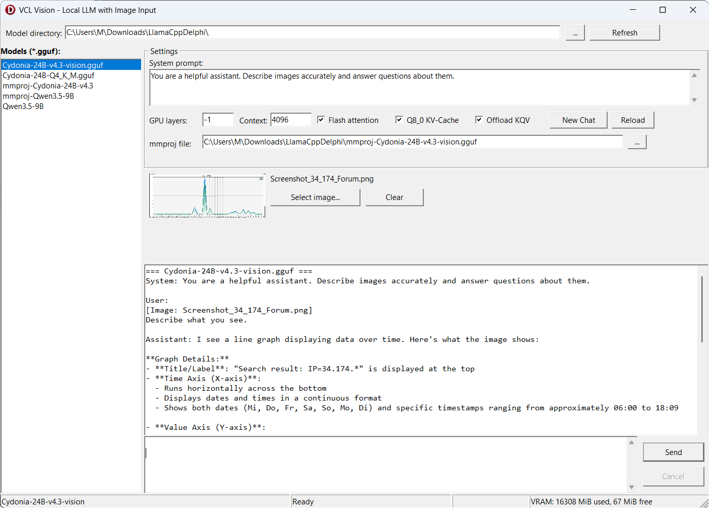

# llama-cpp-delphi — Updated for llama.cpp b9090 · Delphi 11+

> **Based on the original work by Lucas Moura Belo (lmbelo) for Embarcadero:**
> [github.com/Embarcadero/llama-cpp-delphi](https://github.com/Embarcadero/llama-cpp-delphi)
> 
> This fork updates the Delphi bindings from the original llama.cpp build b3 (January 2025) to the current build **b9090 (May 2026)** and extends compatibility down to **Delphi 11 Alexandria**. 

---

## Why this fork?

The original bindings were written against the llama.cpp b3 API, which has since changed substantially. Between b3 and b9050, llama.cpp introduced a series of breaking changes: new struct layouts, renamed functions, a redesigned backend loader, a separate `llama_vocab` object, and a new memory API replacing the old KV-cache interface.

Since the Embarcadero version included specific new features from Delphi 12+ for some reason and I am still working with Delphi 11, I had to remove a handful of them and replace them with classes and functions compatible with Delphi 11. That is why this fork is likely not 100% backward compatible with the Embarcadero version.

To use AI at a practical speed, accelerators such as GPUs and TPUs are required. Compared to current CPUs, GPUs are about 5 to 10 times faster. NVIDIA graphics cards are particularly well-suited for this purpose and are reasonably cost-effective when used with CUDA. Tested with a RTX4080 with 16GB VRAM via CUDA 13.

The CUDA 13 build of llama.cpp for RTX graphics cards belongs in `lib\win_x64_cuda_13`.
Download the ZIP from the llama.cpp release page and extract its contents into that directory:

**[llama-b9090-bin-win-cuda-13.1-x64.zip](https://github.com/ggml-org/llama.cpp/releases/download/b9090/llama-b9090-bin-win-cuda-13.1-x64.zip)**

If CUDA is not installed or not supported, the samples fall back to the CPU automatically.
For a different GPU or CUDA version, replace the files in `lib\win_x64_cuda_13` with the
matching build from the [llama.cpp release page](https://github.com/ggml-org/llama.cpp/releases/tag/b9090),
or create a new folder and adjust the DLL path in the sample's `initialization` section.

---

## Highlights

- **llama.cpp b9090** — fully updated API, including the new backend loader, vocab object, memory API, and sampler chain.
- **Delphi 11+ (Alexandria and newer)** — tested on Delphi 11; compatible with Delphi 12 and 13 via the same package set (`packages/d11+/`).
- **CUDA 13: RTX 30xx/40xx/50xx ready** — backend DLL loading via `ggml_backend_load_all_from_path`,
  Flash Attention support, quantized KV cache (Q8_0).
- **`OnLog` event** — intercept llama.cpp log output directly in Delphi, including the
  per-device buffer sizes reported during model load (VRAM vs. RAM split).
- **New settings** — `NSeqMax`, `AttentionType`, `TypeK`, `TypeV`, corrected `UseMMap` wiring.
- **Jinja2 chat template support** — built-in model templates are applied automatically via `llama_chat_apply_template`; EOT markers are probed at load time for reliable stop detection.

---

## Motivation: Qwen3-27B on a single 16 GB GPU

The immediate trigger for this fork was running **Qwen3-27B** (4-bit quantized, ~16 GB model weight) on a single **RTX 4080 (16 GB VRAM)** in a Delphi application - without any middleware between the application and the model.

With the correct settings the model fits comfortably:

```pascal
Settings.NGpuLayers := -1;                             // all layers to GPU
Settings.FlashAttn  := True;                           // Ada Lovelace FA2
Settings.TypeK      := TGGMLType.GGML_TYPE_Q8_0;      // ~50 % KV-cache VRAM savings
Settings.TypeV      := TGGMLType.GGML_TYPE_Q8_0;
Settings.NCtx       := 8192;
Settings.NBatch     := 512;
Settings.NUBatch    := 512;
Settings.OffloadKQV := True;
```

Flash Attention combined with Q8_0 KV-cache reduces the context memory footprint enough that even a 27B model leaves headroom for a usable context length on 16 GB of VRAM.

---

## llama.cpp directly vs. Ollama

Ollama is a convenient wrapper, but it introduces a full HTTP server layer between
your application and the model. Using llama.cpp directly through these bindings gives you:

|                      | **llama.cpp direct**              | **Ollama**                      |
| -------------------- | --------------------------------- | ------------------------------- |
| Latency              | Zero network round-trips          | HTTP request overhead per call  |
| Memory               | Model + runtime only              | Model + Ollama service overhead |
| Parameters           | Full API access                   | Subset exposed via Modelfile    |
| KV cache control     | TypeK/TypeV, NSeqMax, OffloadKQV  | Not configurable                |
| Flash Attention      | Direct enum control (Auto/On/Off) | Managed internally              |
| Speculative decoding | Supported                         | Not exposed                     |
| Custom samplers      | Yes (grammar, logit bias, DRY, …) | Limited                         |
| Embeddings           | Full pooling control              | Basic                           |
| Process model        | In-process, no service to manage  | Background daemon               |
| Integration          | Native Delphi component (TLlama)  | REST client boilerplate         |

For a Delphi desktop or server application that needs tight control over inference
parameters, memory usage, and throughput, in-process bindings are the cleaner
and more efficient choice.

---

## What changed from b3 to b9090

### 1. Backend / DLL loader

llama.cpp now loads backends as separate shared libraries (`ggml-base.dll`,
`ggml-cpu.dll`, `ggml-cuda.dll`, …). The bindings call
`ggml_backend_load_all_from_path(dir)` before the first model load. Without this
step, CUDA acceleration is silently unavailable.

### 2. Struct layouts

`TLlamaModelParams`, `TLlamaContextParams`, and `TLlamaSamplerChainParams` have
new fields, reordered members, and changed types. All records were rewritten
to match the current C headers exactly, with explicit offset comments to make
future drift visible at a glance.

Notable additions to `TLlamaContextParams`:

- `NSeqMax` — maximum parallel sequences (required for recurrent models)
- `AttentionType` — causal vs. non-causal attention
- `FlashAttnType` — replaces the former boolean; now an enum (`Auto`/`Enabled`/`Disabled`)
- `OpOffload`, `SwaFull`, `KvUnified` — new GPU/memory control flags
- `NoPerformance` — disable perf counters

Notable additions to `TLlamaModelParams`:

- `UseDirectIo` — bypass OS file cache
- `CheckTensors` — validate tensor data on load (useful for debugging)
- `UseExtraBufts` — weight-repacking optimization

### 3. Function renames

| Old name                       | New name                     |
| ------------------------------ | ---------------------------- |
| `llama_load_model_from_file`   | `llama_model_load_from_file` |
| `llama_free_model`             | `llama_model_free`           |
| `llama_new_context_with_model` | `llama_init_from_model`      |
| `llama_n_vocab`                | `llama_vocab_n_tokens`       |
| `llama_token_bos`              | `llama_vocab_bos`            |
| `llama_tokenize(model, …)`     | `llama_tokenize(vocab, …)`   |

### 4. Vocab as a separate object

`llama_vocab` is now an opaque struct retrieved via `llama_model_get_vocab(model)`.
All tokenizer and token-info functions take `vocab` instead of `model`.
`TLlamaModel.Vocab` exposes the pointer; all wrapper methods use it transparently.

### 5. Memory API (replaces KV-cache API)

`llama_kv_cache_*` and `llama_kv_self_*` are gone. The new API:

```
llama_get_memory(ctx)  →  llama_memory_t
llama_memory_clear / seq_rm / seq_cp / seq_keep / seq_add / seq_div / seq_pos_max
```

`TLlamaContext` methods (`KVCacheClear`, `KVCacheSeqRm`, …) are preserved as Pascal
names and route to the new API internally.

### 6. Sampler updates

`llama_sampler_init_grammar` and `llama_sampler_init_infill` now take `vocab`
instead of `model`. The `penalties` sampler signature is simplified.
`TLlamaSamplerI` gains four experimental GPU-side sampling fields
(`BackendInit`, `BackendAccept`, `BackendApply`, `BackendSetInput`).

### 7. Batch API

`llama_batch_get_one` no longer takes `pos_0` and `seq_id` — they are tracked
automatically. The batch struct and `TLlamaBatch` wrapper are updated accordingly.

### 8. Chat template (Jinja2)

`llama_chat_apply_template` no longer accepts a `model` argument — it takes the
raw template string (or `nil` to use the model's built-in template).
`llama_model_chat_template(model, name)` retrieves the built-in template.

`TJinja2ChatFormatter` now probes the template at load time: it applies the
template with a sentinel string as the last assistant message and extracts
whatever follows as the EOT marker (e.g. `</s>`, `<|im_end|>`, `<|eot_id|>`).
The marker is added to the stop sequence list, ensuring generation halts correctly
on models where `llama_vocab_is_eog` alone is insufficient.

### 9. FPU / SSE exception masking

Delphi unmasks certain floating-point exceptions by default; llama.cpp and ggml
expect all FP exceptions masked (matching C/C++ runtime defaults). All DLL calls
that perform numerical computation are wrapped with `SetExceptionMask` / restore,
eliminating spurious `FLOAT_INVALID_OPERATION` and `FLOAT_DIVIDE_BY_ZERO` exceptions.

### 10. Bug fixes

- `TLlamaSettings.UseMMap` was never applied to `TLlamaModelParams`. Fixed.
- Speculative decoding passed an out-of-range logit index to `llama_sampler_sample`
  when `LogitsAll = false`. Fixed.
- `TGGMLType` enum had a gap at values 4–5 (removed quantisation types), causing
  Delphi's RTTI to hide `TypeK`/`TypeV` in the Object Inspector. Fixed.
- Closure lifetime bug: captured `LData`/`LText` in the streaming anonymous method
  could be freed before last access. Fixed by capturing raw pointers instead.
- `TCompletionLogprobs` AV: generic `TDict<string, Single>` as a `TArray` element
  type caused Delphi to emit invalid TypeInfo, corrupting the stack over streaming.
  Fixed by introducing a named concrete type `TTopLogprobMap`.
- Stop strings from the chat formatter were silently discarded because
  `TChatFormaterAdapter.Prepare` took `TLlamaChatCompletionSettings` by value
  (a record). Fixed by changing the parameter to `var`.
- `Detokenize` was called with `special=False` in the generation loop, so EOT
  tokens (e.g. `</s>`) never appeared in the accumulated text and stop-string
  matching failed. Fixed by passing `special=True`.
- Default chat temperature was 0.2, causing severe repetition loops on many models
  (the distribution is so peaked that `repeat_penalty=1.1` cannot escape a loop).
  Changed to 0.8, matching the llama.cpp and Ollama defaults.

### 11. New TLlama features

- **`OnLog` event** (`TLlamaLogEvent`) — receives all llama.cpp log messages,
  including the per-device buffer-size lines emitted during model load:
  
  ```
  llm_load_tensors: CUDA0 buffer size = 15234.56 MiB
  llm_load_tensors: CPU  buffer size =   312.00 MiB
  ```

- **`NSeqMax`** and **`AttentionType`** added to `TLlamaSettings`.

- **`FlashAttn`** (boolean) correctly maps to the new `FlashAttnType` enum
  (`LLAMA_FLASH_ATTN_TYPE_ENABLED` / `DISABLED`); `AUTO` is available via
  `TLlamaFlashAttnType` directly.

---

## Project structure

```
packages/
  d11+/          Delphi 11, 12, 13+ (Alexandria and newer)
src/
  Api/           Low-level DLL bindings (LlamaCpp.Api.*.pas)
  Common/        Settings, types, samplers, chat, grammar, cache
  CType/         C-type translations (Ggml, Llama, Llava)
  Wrapper/       Mid-level wrappers (LlamaModel, LlamaContext, LlamaBatch)
  LlamaCpp.Llama.pas   TLlama component (main entry point)
  LlamaCpp.*.pas       High-level subsystems
samples/
  VclChat/                   Minimal VCL chat sample (Windows)
  VclVision/                 VCL multimodal sample — image + text inference (Windows)
  SimpleChatWithDownload/    FMX sample with HuggingFace model download
test/            DUnit test suite
lib/
  win_x64_cuda_13/    DLLs for CUDA 13 — extract llama-b9090-bin-win-cuda-13.1-x64.zip here
```

### Package installation (Delphi 11+)

1. Open `packages/d11+/LlamaCpp.dproj` → **Compile** → **Install**
2. Open `packages/d11+/dclLlamaCpp.dproj` → **Compile** → **Install**

`dclLlamaCpp` depends on `LlamaCpp`, so the order matters.
Delphi 12/13 will offer to migrate the project format on first open — accept.

### DLL setup (CUDA 13)

1. Download **[llama-b9090-bin-win-cuda-13.1-x64.zip](https://github.com/ggml-org/llama.cpp/releases/download/b9090/llama-b9090-bin-win-cuda-13.1-x64.zip)** from the llama.cpp releases.
2. Extract the ZIP contents directly into `lib/win_x64_cuda_13/`.
   The directory must contain at least `ggml.dll`, `ggml-base.dll`, `ggml-cpu.dll`, `llama.dll`,
   and `ggml-cuda.dll` (plus the CUDA runtime DLLs shipped in the ZIP).
3. For vision support, `mtmd.dll` must also be present — it is included in the same ZIP.

> For a different GPU or CUDA version, use the matching build from the
> [llama.cpp release page](https://github.com/ggml-org/llama.cpp/releases/tag/b9090)
> and adjust the DLL path in the sample's `initialization` section accordingly.

---

## Quick start

```pascal
procedure TForm1.FormCreate(Sender: TObject);
begin
  Llama1.ModelPath := 'C:\models\qwen3-27b-q4_k_m.gguf';
  Llama1.Settings.NGpuLayers := -1;
  Llama1.Settings.FlashAttn  := True;
  Llama1.Settings.TypeK      := TGGMLType.GGML_TYPE_Q8_0;
  Llama1.Settings.TypeV      := TGGMLType.GGML_TYPE_Q8_0;
  Llama1.Settings.NCtx       := 8192;
  Llama1.OnLog               := HandleLlamaLog;
  Llama1.Init();
end;

procedure TForm1.HandleLlamaLog(Sender: TObject;
  const ALevel: TGgmlLogLevel; const AText: string);
begin
  if ALevel >= GGML_LOG_LEVEL_WARN then
    Memo1.Lines.Add('[WARN] ' + Trim(AText))
  else
    Memo1.Lines.Add(Trim(AText));
end;
```

### Chat completion

```pascal
var
  LMessages: TArray<TChatCompletionRequestMessage>;
  LSettings: TLlamaChatCompletionSettings;
begin
  LMessages := [
    TChatCompletionRequestMessage.System('You are a helpful assistant.'),
    TChatCompletionRequestMessage.User('What is the capital of France?')
  ];

  LSettings := TLlamaChatCompletionSettings.Create(LMessages);
  // Optional overrides (defaults match Ollama):
  // LSettings.Temperature  := 0.8;   // default
  // LSettings.RepeatPenalty := 1.1;  // default
  // LSettings.MaxTokens    := 512;

  Llama1.CreateChatCompletionStream(LSettings);
end;
```

---

## VclVision sample

`samples/VclVision/` is a Windows VCL application for multimodal (vision) inference.
It lets you load an image alongside a text prompt and have the model describe or answer
questions about it.



### What you need

| File            | Description                                               |
| --------------- | --------------------------------------------------------- |
| `*.gguf`        | The text model (same as for chat)                         |
| `mmproj-*.gguf` | The matching multimodal projector file                    |
| `mtmd.dll`      | Ships with llama.cpp b9050+; must be in the DLL directory |

The text model and the mmproj file must come from the same model release —
mixing them from different versions will cause `mtmd_init_from_file` to fail.

### Tested models

| Model                  | mmproj                           | Notes                            |
| ---------------------- | -------------------------------- | -------------------------------- |
| Qwen2.5-VL-7B-Instruct | `mmproj-qwen2.5-vl-7b-q8_0.gguf` | Strong multilingual vision model |
| LLaVA-1.5-7B           | `mmproj-llava-1.5-7b.gguf`       | Widely available reference model |
| Gemma3-12B             | `mmproj-gemma3-12b.gguf`         | High quality, needs ~12 GB VRAM  |
| MiniCPM-V-2.6          | `mmproj-minicpm-v2_6.gguf`       | Compact, good for limited VRAM   |

### How it works

The sample uses the `mtmd` API introduced in llama.cpp b9050:

1. The text model is loaded via the standard `TLlama` component.
2. `mtmd_init_from_file` creates a multimodal context from the mmproj file and
   the loaded text model (`Llama1.LlamaModel`).
3. For each user turn with an image:
   - The image is decoded into a raw RGB bitmap via `mtmd_helper_bitmap_init_from_file`.
   - The prompt (system + `<__media__>` marker + question) and the bitmap are
     tokenized together with `mtmd_tokenize`.
   - All chunks (text tokens and image embeddings) are written into the KV cache
     via `mtmd_helper_eval_chunks`.
   - Token generation then proceeds through the standard `TLlama.Generate` call,
     with `AReset = False` so the KV cache populated by mtmd is preserved.
4. Text-only turns (no image selected) go through the normal `Eval` + `Generate` path.

### Settings

The settings panel exposes the same knobs as VclChat (GPU layers, context size,
Flash Attention, Q8_0 KV cache, KQV offload). The mmproj path is a separate field;
both the text model and the mmproj are loaded together when **Load** is clicked.

---

## Recommended models

Any GGUF model that fits in your VRAM works. Well-tested choices:

| Model                 | Size (Q4_K_M) | Notes                                       |
| --------------------- | ------------- | ------------------------------------------- |
| Qwen3-8B              | ~5 GB         | Multilingual, fast, thinking mode           |
| Qwen3-27B             | ~16 GB        | High quality, fits 16 GB VRAM with FA+Q8 KV |
| Mistral-7B-Instruct   | ~4 GB         | Fast, reliable for English                  |
| LLaMA-3.1-8B-Instruct | ~5 GB         | Good general purpose                        |

Models are available at [huggingface.co](https://huggingface.co) in GGUF format.

---

## Credits

Original project: **llama-cpp-delphi** by Embarcadero
https://github.com/Embarcadero/llama-cpp-delphi

llama.cpp: **ggml-org/llama.cpp**
https://github.com/ggml-org/llama.cpp

---

## License

MIT — see [[LICENSE]](https://github.com/Cypheros-de/Delphi11LlamaCppBindings#MIT-1-ov-file) for details.

---

## About

Developed by **Cypheros** as a personal exploration of AI-assisted Delphi development, using Claude Code (Anthropic).

[www.cypheros.de](https://www.cypheros.de)
